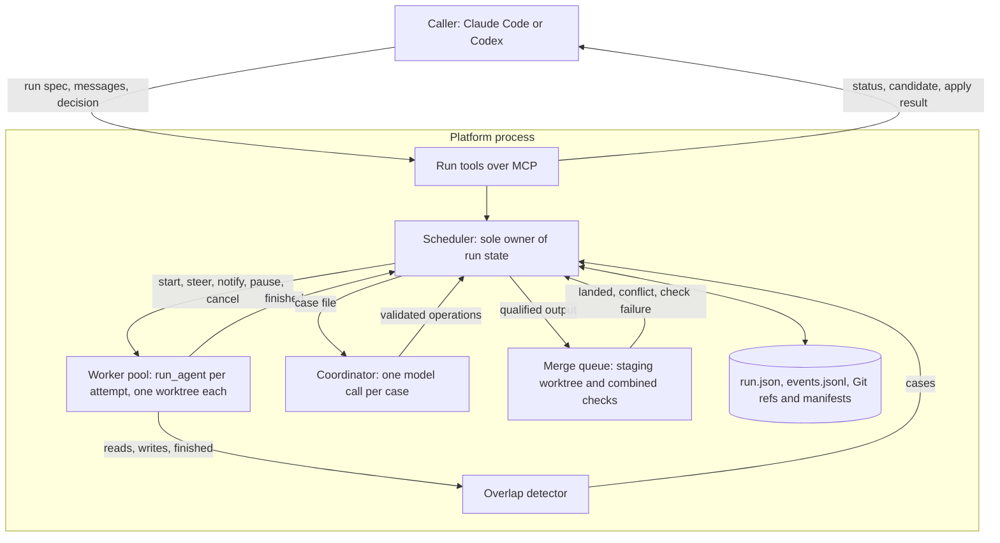

# Subagent coordination platform

## Contents

- [Objective and working agreement](#1-objective-and-working-agreement): outcome, success measure, review gates and scope.
- [Architecture](#2-architecture): components, roles and the principles that place each decision.
- [Rejected alternatives](#3-rejected-alternatives): designs considered and why they lost, so later steps do not reopen them.
- [Existing components and reuse](#4-existing-components-and-reuse): code to build on and boundaries that need adapting.
- [Contracts and lifecycle](#5-contracts-and-lifecycle): records, scheduling, workers, overlap detection, coordinator, merge queue, acceptance and state.
- [Deferred interfaces](#6-deferred-interfaces): browser UI and network exposure.
- [Application structure](#7-proposed-application-structure): proposed modules.
- [Code hygiene and documentation](#8-code-hygiene-and-documentation): quality gates and documentation ownership.
- [Implementation steps](#9-step-by-step-implementation): ordered steps with exit criteria.
- [Open decisions](#10-decisions-to-confirm): choices still requiring agreement.

Status: planning only. Implementation under this plan has not started. This version replaces the earlier wave-based plan with an internal orchestrator and merge subagent.

## 1. Objective and working agreement

Build a local platform that runs a caller's task graph with parallel editing subagents, each in its own Git worktree, and returns a tested candidate that the caller accepts before the platform applies it to the target branch. The caller is the external agent that submits the graph, such as Claude Code or Codex. Inside the platform, code schedules, detects overlaps, merges and applies; a coordinator model is called only to resolve overlaps that code has detected. Submission never authorizes application: the caller must accept one exact candidate.

Better task decomposition reduces conflicts between editing workers but cannot rule them out. The design therefore assumes overlaps will happen while workers run, detects them as they happen, and resolves them before they reach the target branch.

**Success measure.** The platform has to beat the manual flow it replaces: the host creating worktrees with `deepseek-worktree`, delegating, inspecting, committing and integrating by hand. For the multi-task cases added in Step 1, a run must take less host time and token cost than the manual flow, with no lower success rate and no unsafe acceptance, as reported by `scripts/evaluate_delegation.py`. Each model role in this plan must justify its cost against that measure.

Working agreement:

- Work through one agreed step at a time. Before edits, state the scope, existing components to reuse, proposed changes and verification.
- Keep patches small enough to explain and review. Split a step when it contains independently reviewable changes.
- After each step, report the changes, actual check results, limitations and noteworthy decisions. Tick its checkbox only when its exit criteria pass, then stop for review.
- Preserve unrelated working-tree changes. This plan does not authorize implementation, commits, pushes or dependency upgrades.

**First-release scope:** local, single owner, one repository per run (the server's workspace), bounded parallel editing workers. Read-only explorers stay on the existing read-only delegation tools and are not part of a run (see Section 10). Out of scope: distributed execution, multi-tenant hosting, automatic task decomposition, network exposure and a general agent framework.

## 2. Architecture



### Principles

1. **A model only where judgment is needed.** Scheduling, overlap detection, merging, checking and applying are code. Task workers write code; the coordinator decides how to resolve a detected overlap. Nothing else calls a model.
2. **Code detects, the coordinator resolves.** Detection runs after every worker write at no model cost. The coordinator can judge only what detection shows it, so detection defines coverage and the coordinator adds judgment, not reach.
3. **One writer per worktree.** Each attempt edits only its own worktree, so every change in it belongs to that attempt, including changes made by Bash. That attribution is what makes detection possible; a shared checkout cannot provide it.
4. **Git holds the outputs.** A captured output is a commit, a landed output is an ancestor of the validated tip, the candidate is a commit, and acceptance is a ref to that commit. Run state stores only what Git cannot: the graph, attempt index, cases, decisions and messages.
5. **One owner for run state.** The scheduler consumes one event queue and is the only code that changes run state. Workers, checks, landings and coordinator calls run elsewhere and report back as events, so no handler blocks on I/O and no two threads race on state.

### Roles and authority

| Role | Is | Does | Cannot |
| ---- | -- | ---- | ------ |
| Caller | External agent (Claude Code, Codex) | Submits the run spec, sends messages, answers escalations, accepts, revises or rejects a candidate. | Accept anything but an exact candidate commit. |
| Scheduler | Code | Validates the graph, starts attempts, routes messages and notifications, applies coordinator operations, owns run state. | Read or edit worktree contents on a model's behalf. |
| Overlap detector | Code | Records read and write sets, compares them across attempts and landings, opens and updates cases. | Decide how a case is resolved. |
| Coordinator | Model, one stateless call per case | Chooses operations from a fixed set to resolve a case or answer a worker message. | Touch files, Git, shell, permissions or acceptance; drop required work. |
| Task worker | Model, existing `run_agent` | Implements one task in its own worktree with the coding tools, messages the coordinator. | Use Git in any form, reach other worktrees, commit or merge. |
| Merge queue | Code | Lands qualified outputs on a staging branch, runs combined checks, advances the validated tip, applies an accepted candidate. | Advance the tip past a failed check or apply without acceptance. |
| User | Person watching the run | Sends messages through the caller or later the browser UI, uses run controls. | Grant acceptance or permissions through a message. |

"Orchestrator" in the existing README and host instructions means the caller. This plan therefore names the internal model role "coordinator" and the code that replaced the old internal orchestrator "scheduler".

## 3. Rejected alternatives

| Alternative | Why it lost |
| ----------- | ----------- |
| All workers on one branch, with the platform granting file mutexes per tool request | Test runs would see other workers' half-finished edits, so a consistent test needs a whole-tree lock that blocks every writer. A lock held per tool call adds nothing to the existing atomic edits, and a lock held from read to edit spans model calls and deadlocks. Bash cannot declare its writes in advance, and changes made by concurrent Bash commands cannot be attributed afterwards. File locks also miss the costly conflicts, which span files. Isolating Bash rebuilds worktrees. |
| Internal orchestrator model with management tools for every run | Readiness and accounting are rules; report judgment repeated the caller's own judgment with less context. Its one real job, resolving overlaps between running workers, is kept as the coordinator. |
| A full-time coordinator session watching the whole run | Its context fills with everything that happens and is compacted mid-run, so decisions drift. A stateless call per case with a complete case file costs per conflict instead of per hour and keeps its memory in recorded decisions. |
| Merge subagent for every integration and apply subagent for the final merge | A clean merge plus checks needs no interpretation, and an agent restricted to one fixed apply tool adds only the chance of calling it wrongly. An agent holding the integration checkout also forced lease handoffs between agent and host. |
| Bounded waves with a barrier between them | A dependent waits for the slowest task of the previous wave, one unrelated failure stalls the snapshot, and a wave's conflicts can involve several tasks with no owner. The merge queue lands each output as it qualifies and attributes each failure to one task. |
| Separate durable store (SQLite, operation journal, owner fencing) | It duplicates what Git and the worktree manifests already record and needs a journal to reconcile the two after a crash. Each step's outcome is visible in Git, so recovery reads Git. SQLite remains an option later as a rebuildable index for the UI. |
| Peer-to-peer message bus between workers | One worker's text would reach another as instructions, and the traffic bypasses the graph. Worker messages go through the coordinator instead. |
| Adopting pydantic-deepagents as the runtime | Its team members share one workspace with no edit coordination, and its forks select one winning branch rather than combining parallel work, with whole-file conflict checks. Adopting it would replace this repository's safety layer without solving coordination. Borrowed ideas: claimable tasks with `blocked_by`, a per-agent inbox read between turns, and linking a shared environment into isolated copies for tests. |

## 4. Existing components and reuse

| Existing component | Use in this plan |
| ------------------ | ---------------- |
| `agent_loop.run_agent` | Runs every task attempt unchanged in its own thread. Steering, finalization and cancellation already arrive through `control_poll`, `control_finalize` and `cancel_signal`. Add one optional event callback for observation and detection. |
| `job_manager.py` | Pattern for thread start, outcome mapping and lease release. Its single slot stays for the existing tools; runs get their own multi-slot pool. |
| `worktrees.py`, `worktree_support.py` | `create` with `--base` provisions each attempt and the staging worktree; `inspect` reports a worktree's changed paths; `integrate` and `cleanup` supply the guarded merge and removal logic; `common_lock` and `hold_lease` serialize Git and checkout access. |
| `execution_lock.py` | Each attempt holds its worktree's exclusive execution lease, which already enforces one writer per worktree. |
| `tool_evidence.py`, `run_evidence.py`, `result_contract.py` | Read receipts carry the path and sha256 of every file read, which form the attempt's read set. Receipts keep worker claims separate from verified outcomes. |
| `transaction_journal.py`, `transaction_recovery.py` | Journaled Write/Edit/NotebookEdit mutations give file-tool write events; unresolved recovery records block output capture. |
| `provider_retry.py`, `provider_child.py` | The coordinator's single model request reuses this request path, its limits and the user-owned model configuration. |
| `worktree_policy.py`, `safety.py`, `host_instructions.py` | Keep the no-Git policy and the checkout boundary for every task worker. |
| `external_mcp_*` | Pattern for adding a non-file tool to a worker (`message_coordinator`). Existing allowlists stay unchanged. |
| `server.py` and existing tools | Unchanged. The file is at the 500-line limit, so run tools register from a new module. |
| `scripts/evaluate_delegation.py` | Measures runs against the manual flow for the success measure. |

Boundaries that need deliberate adaptation:

1. **Steering framing.** `control_poll` messages are presented as a "Parent agent steering update" that overrides earlier instructions and skips the remaining planned tool calls. Coordinator directives may use that framing. Overlap notifications are data from another task and need their own labelled framing without override authority. Whether a notification also skips the pending tool batch is settled in Step 2.
2. **Pause.** The scheduler implements pause and conditional wait by blocking inside the `control_poll` callback until resume or cancel. The attempt's hard deadline keeps running while paused (see Section 10).
3. **Conflict state.** `integrate` leaves a conflicted merge in the target for manual resolution. The merge queue needs the opposite: a conflict must leave no merge in progress. Either detect conflicts with `git merge-tree --write-tree` (Git 2.38 or later) before touching a checkout, or abort in the platform-owned staging worktree.
4. **Output capture.** There is no host operation that commits a worker's changes. Add a narrow one that commits all changes in an attempt's worktree on its own branch, with hooks disabled through the existing hooks mechanism.
5. **Worker tool set.** Task workers gain `message_coordinator`. Capability binding, schemas and serialization must add it without widening any existing profile or inheriting external-tool defaults.
6. **Legacy behavior.** Characterization tests pin the existing single-job tools before any shared code moves.

## 5. Contracts and lifecycle

### Records

| Record | Holds |
| ------ | ----- |
| Run spec | Schema version, target ref and expected head, tasks, limits, setup commands, check profiles. |
| Task | Stable ID, objective, `depends_on`, `writes` (allowed paths), optional `reads`, task checks, acceptance notes for the worker. |
| Attempt | Platform ID, task ID, graph revision, base commit, worktree manifest, status, read set, write set, captured commit, receipt. |
| Case | ID, kind, attempts or landing involved, paths, diff references, status (open, decided, closed), decision history. |
| Decision | Case ID, actor (coordinator, caller or default policy), operations, outcome of each operation. |
| Message | ID, sender and provenance, recipient (task, coordinator or run), text, delivery status. |
| Landing | Output, staging commit, check receipts, result (landed, conflict, check failure), validated tip before and after. |
| Candidate | ID, commit, base, landed output per task, check receipts, open issues. |
| Acceptance and apply | Actor, candidate ID and commit, expected target head, decision, apply outcome. |
| Event | Per-run sequence number, time, kind, record IDs, bounded payload. |

A task graph is data. Reject duplicate IDs, unknown dependencies, cycles, unknown check profiles, paths outside the repository and requests exceeding configured limits before any worktree exists. Runtime IDs and filesystem locations come from the platform, never from task text.

Contract outline; field names are illustrative:

```json
{
  "schema_version": 1,
  "target": {"ref": "main", "expected_head": "<full-commit-id>"},
  "limits": {"max_active_attempts": 2, "max_attempts_per_task": 2, "max_coordinator_calls": 20},
  "setup": ["<environment command run by the platform in each new worktree>"],
  "checks": {
    "landing": ["python -m unittest discover -s tests"],
    "candidate": ["python -m unittest discover -s tests"]
  },
  "tasks": [
    {
      "id": "contracts",
      "objective": "Define the run and task records with graph validation",
      "depends_on": [],
      "writes": ["src/deepseek_mcp/run_contracts.py", "tests/test_run_contracts.py"],
      "reads": ["src/deepseek_mcp/result_contract.py"],
      "checks": ["python -m unittest tests.test_run_contracts"],
      "acceptance_notes": ["Cyclic graphs are rejected"]
    }
  ]
}
```

### Lifecycles

Illustrative states, completed into transition tables in Step 2:

| Record | States |
| ------ | ------ |
| Run | Validating, Running, NeedsDecision, CandidateReady, Applying, Applied, Blocked, Cancelling, Cancelled, Failed. |
| Task | Waiting, Ready, Active, Qualifying, Landing, Landed, Failed, Superseded. |
| Attempt | Provisioning, Running, Paused, Cancelling, Finished, Qualified, Rejected, Interrupted. |
| Case | Open, Deciding, Decided, Closed. |

Keep worker completion, qualification, landing, candidate readiness, acceptance and application as separate transitions. A worker's completion claim never satisfies a dependency.

### Scheduling

1. Resolve the target to the run's base commit without changing the caller's checkout.
2. **Overlap check before dispatch.** Two tasks may run at the same time only if neither's `writes` intersects the other's `writes` or `reads`. Otherwise the scheduler orders them as if one depended on the other and records why. This prevents the most likely conflicts at the cost of a set comparison.
3. A task is ready when every prerequisite has landed. It starts from the current validated tip.
4. Respect `max_active_attempts`. A retry always gets a new attempt ID and a new worktree.
5. Graph revisions (an added dependency, a narrowed scope, a dropped task) are versioned. Attempts started under an older revision keep their recorded revision; their outputs are checked against the revision in force when they qualify.

### Worker execution

- The platform creates the attempt's worktree from its base with `deepseek-worktree create`, runs the run's `setup` commands there under the platform's tool policy, and starts `run_agent` in a pool thread holding that worktree's execution lease.
- The worker has the coding tools plus `message_coordinator`. It never receives Git, other worktrees or the staging worktree.
- Steering, notifications, pause, wait and cancel take effect at the existing checkpoints: before each model request and before each tool batch. A running tool call always finishes first, and cancellation is acknowledged only after it has.

### Qualification and capture

When an attempt finishes, the platform waits for its thread to end and releases its lease, then:

1. Blocks capture if the attempt left unresolved mutation-recovery records, and sets the run to NeedsDecision so the caller can review them.
2. Lists changed paths with `inspect` and rejects changes outside the task's `writes`.
3. Runs the task's checks in the worktree and records receipts.
4. Commits all changes on the attempt branch (host capture). Unqualified work is also captured, so a revision attempt can start from it instead of from scratch.

A qualified output joins the merge queue. A rejected one follows the default policy, or the coordinator's decision once Step 7 exists: one revision attempt based on the rejected commit, given the check output, within `max_attempts_per_task`.

### Overlap detection

The detector maintains three sets and compares them after every event that changes one:

- **Read set:** for each attempt, every file read through the Read tool, with the sha256 from its receipt.
- **Write set:** for each attempt, the paths changed relative to its base. File-tool writes come from journaled mutations. Bash is not journaled, so after every Bash command the platform lists the worktree's changed paths with `inspect`.
- **Landed set:** the paths changed by each landing on the validated tip.

| Case kind | Opened when |
| --------- | ----------- |
| `write_write` | Two active attempts have changed the same path. |
| `stale_read` | A path in an active attempt's read set was changed by another active attempt, or by a landing after the attempt's base, and its hash no longer matches. |
| `landing_conflict` | Merging an output into the staging branch conflicts. |
| `landing_check_failure` | Combined checks fail on a merged staging commit. |
| `scope_violation` | A finished attempt changed paths outside its `writes`. |
| `worker_message` | A worker called `message_coordinator`. |
| `run_message` | The caller or user sent a run-level message without a task ID. |

Cases are keyed by the pair of attempts, or by attempt and landing. Further overlaps between the same pair update the open case instead of opening another, and the coordinator is called again only if the case changes after its decision.

Known limit: knowledge a worker gained through Bash output (`cat`, `grep`) or from search results has no read-set entry, so staleness from those sources goes undetected until landing checks. The combined checks remain the final gate.

### Default policy before the coordinator exists

Steps 3 to 6 run with deterministic defaults, which the coordinator later replaces for all but limits:

- `write_write` and `stale_read`: notify each affected worker with the other side's diff for the paths involved, labelled as data from another task, and continue.
- `landing_conflict` and `landing_check_failure`: start a revision attempt of the landing task from the current validated tip, given its previous diff and the conflict or check output, within the retry limit.
- `scope_violation`: reject the output and start one revision attempt with the violation listed.
- `worker_message` and `run_message`: record them and show them in run status for the caller.
- Exhausted retries on a required task set the run to NeedsDecision.

### Coordinator

The coordinator is a function, not an agent session. For each case needing a decision, the scheduler builds a case file and makes one model request with a single `decide` tool whose schema lists the allowed operations. The platform validates the returned operations and applies them through the scheduler. An invalid response is retried once and then escalated to the caller.

The case file holds:

- the case kind and the paths involved
- both task specs and current graph revision
- both diffs for the involved paths, and the landing or check output when relevant
- the involved read-set entries with their hashes
- earlier decisions on cases involving the same attempts, from run state
- the attempts' current statuses and remaining budgets

Allowed operations:

| Operation | Effect |
| --------- | ------ |
| `notify(attempt, text, diffs)` | Delivers labelled information at the attempt's next checkpoint. |
| `direct(attempt, instruction)` | Delivers a coordinator directive through the steering framing, within the task's objective and scope. |
| `pause(attempt)` / `resume(attempt, note)` | Holds or releases the attempt at its next checkpoint. |
| `wait_until(attempt, condition, timeout)` | Pauses until a task lands or an attempt finishes. The platform rejects a wait that would form a cycle and reopens the case on timeout. |
| `add_dependency(task, depends_on)` | Graph revision; the coordinator also states what happens to the running dependent. |
| `narrow_writes(task, paths)` | Graph revision; existing changes outside the new scope are caught at qualification. |
| `restart(task, base, note)` | Cancels the current attempt and starts a new one from the validated tip or from another task's captured commit. |
| `escalate(question)` | Sets the run to NeedsDecision; the caller's answer returns as a case update. |
| `close(note)` | Closes the case with a recorded reason. |

The coordinator has no other tools, so it cannot read files, use Git or shell, change permissions, accept candidates or drop required work. Dropping or redefining required work is a caller decision through `escalate`. One case is decided at a time per attempt pair; unrelated cases may be decided concurrently. `max_coordinator_calls` caps cost per run, after which cases fall back to the default policy and escalation.

### Messages

| From | To | Route |
| ---- | -- | ----- |
| Caller or user, with a task ID | That task's active attempt | Scheduler, through steering at the next checkpoint. |
| Caller or user, without a task ID | Run | `run_message` case for the coordinator. |
| Worker | Coordinator | `message_coordinator` opens a `worker_message` case. The tool returns at once; the reply arrives at a later checkpoint. |
| Coordinator | Worker | `notify` or `direct`, labelled with its origin. |

No worker's text reaches another worker except as content the coordinator chose to forward inside a labelled notification. Messages, notifications and progress events never count as acceptance, permission or completion. Messages addressed to a finished or superseded attempt are rerouted to the task's current attempt or rejected with a reason.

### Merge queue

- Each run has a platform-owned staging worktree on a staging branch, and a validated-tip ref that starts at the base commit. No worker is ever assigned the staging worktree.
- Landing one output: reset staging to the validated tip; merge the output's captured commit; on conflict, leave no merge in progress and open `landing_conflict`; otherwise run the landing checks in the staging worktree; on failure open `landing_check_failure`; on success advance the validated tip to the staging commit by compare-and-swap on the ref.
- The first release lands one output at a time in order of qualification. Batching is a later option (Section 10).
- After each landing, the detector compares the landed set with every active attempt's read set.
- Every Git operation runs under `common_lock`.

### Candidate, acceptance and apply

- When every required task has landed, the platform runs the candidate checks on the validated tip if they differ from the landing checks. The candidate is that commit, reported with the task-by-task coverage, check receipts, skipped checks and open issues.
- The caller accepts by naming the candidate ID and commit. The platform records acceptance as a ref pointing at that commit plus a decision record.
- Apply is platform code. It verifies the acceptance ref, the target's expected head, a clean target checkout with no merge in progress, and the candidate's descent from the base, then merges the candidate into the target and verifies that the resulting tree equals the candidate's tree.
- If the target moved since the base, the platform lands the target's new commits through the merge queue, which produces a new candidate needing new acceptance.
- Never force-reset the target, overwrite unrelated changes or push. A partial apply failure is reported with enough state to recover.

### State, topology and recovery

- Run state lives in `.deepseek-as-subagent/.state/runs/<run-id>/`, outside every worker root. `run.json` holds the spec, graph revisions, attempt index, cases, decisions, messages and acceptance, written by atomic replace. `events.jsonl` is an append-only, size-bounded event log with sequence numbers for observation; it is never authoritative.
- Git and the worktree manifests hold attempt branches, captured commits, the staging branch, the validated tip and the acceptance ref.
- Every external step's outcome is checkable in Git, so recovery re-reads instead of replaying. A worktree exists or not, a capture commit exists or not, and the validated tip moved only after checks passed, so staging state can always be discarded.
- **Topology.** The server runs over stdio as a child of the caller, worker threads live inside it, and helper processes exit with their parent. Closing the caller therefore interrupts every run. Step 1 decides whether runs are bound to the server's lifetime or a background service keeps them alive (Section 10), and Step 8 is sized by that choice.
- Until Step 8, an interrupted run is abandoned and its worktrees are kept for inspection.
- Redact secrets before anything is persisted. Bound retained output, events and artifacts, with explicit cleanup.

### Permissions

This is a design for cooperating agents. Worktrees, path checks and scope inspection are not an OS sandbox, especially with Bash enabled; containing hostile agents or untrusted code needs a separately approved isolation design.

- Task workers keep the existing coding tools and no-Git policy, confined to their own worktree.
- The coordinator has only `decide`.
- Git mutations are platform code under `common_lock`.
- Workers cannot add external servers, widen profiles or change their own permissions.
- Model configuration stays user-owned: neither the caller nor the coordinator can select another model, provider or reasoning level.

## 6. Deferred interfaces

The caller's MCP run tools are part of the core and arrive in Step 5. A browser UI and any network exposure wait until the headless workflow passes Step 9.

The browser UI reads the same run state and `events.jsonl`, with cursor-based replay after reconnect. It shows the graph, each attempt's worktree, branch, current operation, recent tool events, diffs, checks, open cases and coordinator decisions. It offers a message composer and permitted run controls. It never grants acceptance.

Security prerequisites before any HTTP surface:

- Bind to loopback, authenticate access, validate Host and Origin, restrict cross-origin requests and protect mutations against CSRF.
- Apply the same capability checks as the MCP tools; neither interface can bypass them.
- Render worker text, tool output and diffs as untrusted content, after core redaction. Never expose credentials to the browser or logs.

## 7. Proposed application structure

Keep the flat package. These are proposed boundaries, created only when a step needs them:

```text
src/deepseek_mcp/
  run_contracts.py     # Records, graph validation, scope-overlap rule, transition tables
  run_scheduler.py     # Event queue, readiness, attempts, graph revisions, operations
  run_workers.py       # Pool over run_agent, checkpoint controls, pause and wait
  run_capture.py       # Scope check, task checks, host commit capture
  overlap.py           # Read, write and landed sets; case creation and update
  coordinator.py       # Case file, decide request, operation validation
  merge_queue.py       # Staging, landing checks, validated tip, candidate, apply
  run_store.py         # run.json, events.jsonl, run lease, recovery
  run_tools.py         # MCP run tools; server.py is at its size limit
tests/
  test_run_contracts.py
  test_run_scheduler.py
  test_run_workers.py        # Real temporary repositories, fake model
  test_merge_queue.py
  test_overlap.py
  test_coordinator.py        # Scripted model responses
  test_run_tools.py          # MCP contract tests
```

State handlers depend on typed events and pure rules, not on transport code or blocking calls. Introduce interfaces only for real external boundaries or needed test substitution: no actor framework, broker, plugin system, generic repository layer or dependency-injection framework.

## 8. Code hygiene and documentation

Every step must meet these requirements:

- Find the existing behavior to extend before adding a helper or service.
- Use explicit typed inputs, outputs and states. Keep side effects at named boundaries and make thread and process ownership visible.
- Use structured errors instead of broad exception swallowing, and clean up resources through explicit lifecycle handling.
- Test invariants and failure paths, not only the successful run. Routine tests use deterministic fake workers and scripted coordinator responses; live model calls require explicit opt-in.
- Preserve the existing test, source-size, compilation, dependency, security and installer gates. No formatter, linter or type checker is configured; agree any additions in Step 1.
- Keep the Linux, macOS and Windows matrix and Python 3.10–3.12 unless explicitly revised. Keep MCP SDK v1 (`mcp[cli]>=1.28,<2`); v2 examples are not interchangeable.
- Keep dependencies minimal and hash-locked. Do not reimplement what the installed stack or Git already provides.
- Remove superseded code and stale instructions once a replacement is verified.

Source limits, enforced by `tests/test_source_limits.py`: 500 lines per production file, 50 per function, nesting depth 4, complexity 15. Discovery covers only immediate files, so new directories must not become a way around them.

Existing CI commands, baselined in Step 1:

```bash
python -m unittest discover -s tests -v
python -m pip check
python -m pip_audit --local --progress-spinner off
python -m compileall -q src/deepseek_mcp adapters/codex scripts
bash -n install.sh uninstall.sh scripts/claude_helpers.sh adapters/codex/install.sh adapters/codex/uninstall.sh
```

CI installs hash-locked dependencies and audit tools first. Listing a command here is not a claim that it passed.

Documentation ownership:

| Location | Owns |
| -------- | ---- |
| `PLAN.md` | Pending steps, exit criteria and open decisions. |
| `README.md` and usage docs | Installation, run tools, configuration and examples. |
| `SECURITY.md` | Trust boundaries, including the coordinator's and workers' authority, isolation limits, credentials and exposure. |
| `docs/` | Accepted contracts and recovery behavior; short decision records for noteworthy trade-offs. |
| Tests and schemas | Executable contract details; prose links to them instead of copying them. |

Document a decision only once it exists in code, with one authoritative explanation per rule. Reconcile `TODO.md`'s concurrent-subagent and observability items with this plan when implementation begins.

## 9. Step-by-step implementation

All steps are pending. A checkbox records verified completion, not intent.

### [ ] Step 1 — Confirm scope, decisions and baseline

- Review the uncommitted work, existing tests and CI, and record actual baseline checks without altering unrelated work.
- Settle the Section 10 rows marked Step 1.
- Add multi-task cases to `tests/fixtures/delegation_cases.json` for the success measure, including at least one pair of tasks that overlap at runtime despite disjoint declared scopes.
- Exit: decisions recorded in Section 10, baseline recorded below, success cases defined.

Current baseline: partial, Linux with Python 3.12.3 and Git 2.43.0.

| Check | Observed result |
| ----- | --------------- |
| `PYTHONPATH=src python -m unittest discover -s tests -p test_source_limits.py -v` | Passed, 1 test. |
| `PYTHONPATH=src python -m unittest discover -s tests -p test_worktrees.py -v` | Passed, 55 tests against temporary repositories. |
| Python compilation and shell syntax commands in Section 8 | Passed. |
| `python -m pip check` | Passed for the system environment only; does not verify project dependencies. |
| Full unittest suite and vulnerability audit | Not run: project dependencies and `pip-audit` are absent. Nothing installed. |
| macOS, Windows, Python 3.10 and 3.11 | Not exercised locally; retain the CI matrix. |

Current limits are not platform defaults: managers admit one execution, tools run sequentially, and provider retries are separate from task attempts. Run limits need explicit values, not the illustrative JSON.

### [ ] Step 2 — Contracts and pure rules

- Implement versioned records, graph validation, the scope-overlap rule, readiness, graph revisions and serialization.
- Complete transition tables for run, task, attempt and case: every state/event pair handled, ignored, deferred or rejected, with guards, emitted effects, timeouts and late or duplicate events.
- Decide the notification framing and whether a notification skips the pending tool batch.
- Exit: tests cover invalid graphs, overlap ordering, readiness, every transition, stale revisions and round-trip serialization, without model or Git calls.

### [ ] Step 3 — Worker pool and output capture

- Add the scheduler's event queue, the multi-slot pool over `run_agent`, worktree provisioning with `setup`, the observation callback, and checkpoint controls for steering, pause and cancel.
- Add qualification: lease release, recovery-record check, scope check, task checks and host capture.
- Apply the default policy for rejected outputs.
- Exit: real temporary-repository tests with a fake model show two attempts editing in parallel in separate worktrees; a scope violation is rejected; failing task checks leave the output unqualified but captured; pause, resume and cancel take effect at checkpoints and never interrupt a running tool; every Git operation holds `common_lock`; workers still cannot use Git; the existing single-job tools pass unchanged.

### [ ] Step 4 — Merge queue, candidate, acceptance and apply

- Add the staging worktree, landings with landing checks, the validated-tip compare-and-swap, conflict handling that leaves no merge in progress, dependents starting from the validated tip, candidate checks and report, the acceptance ref and guarded apply.
- Apply the default policy to landing failures.
- Exit: tests show that a clean merge with failing checks does not advance the tip; a conflict leaves no merge in progress in any checkout; a dependent starts only after its prerequisites land; the candidate covers every required task; acceptance of a wrong or stale candidate, a moved target, a dirty target and a duplicate apply are refused or idempotent; the target is untouched before acceptance; the applied tree equals the candidate's tree.

### [ ] Step 5 — Run tools for the caller (first usable slice)

- Register run tools from `run_tools.py`: start a run, read status and events by cursor, send a message, cancel a run or task, read the candidate, and decide (accept, revise or reject). Names follow the existing `*_deepseek*` pattern.
- Update host instructions, the skill and the Codex adapter's explicit allowlist. Leave the existing tools unchanged.
- Run the Step 1 success cases against the manual flow (opt-in live runs) and record the results here.
- Exit: MCP contract tests drive a fake-worker run from start to applied candidate, including reconnect to a finished run's status; evaluation records exist for the success cases and the comparison is recorded.

### [ ] Step 6 — Overlap detection and notifications

- Build read sets from receipts, write sets from journaled mutations and post-Bash `inspect`, and landed sets from landings.
- Open, key and update cases; deliver default-policy notifications with labelled diffs; add `message_coordinator` with the default recording policy.
- Exit: tests show a Bash-made write detected; `write_write` and `stale_read` cases opened between real worktrees; repeated overlaps updating one case; a landing raising `stale_read` for readers of the landed paths; notifications arriving at the next checkpoint with their provenance label and without override authority.

### [ ] Step 7 — Coordinator

- Build case files, the single `decide` request on the existing provider path, operation validation, and application through the scheduler.
- Add waits with timeout and cycle rejection, escalation to the caller, run-level messages, worker messages, decision records and the per-run call cap.
- Exit: scripted-response tests cover every operation; an invalid response is retried once and then escalated; a cycle-forming wait is rejected; a timeout reopens its case; the coordinator has no capability besides `decide`; one case per attempt pair is decided at a time; decisions persist in `run.json`; past the call cap, cases fall back to the default policy.

### [ ] Step 8 — Restart and resume

- Scope per the Step 1 topology decision. Add a run lease so only one server process owns a run, rebuild state from `run.json`, refs and manifests, mark attempts that were running as Interrupted, discard staging, and resume or report.
- Exit: tests interrupt the process during an attempt, capture, landing, candidate check and apply; resume reaches the same state or an explicit Blocked state and never lands twice or applies a different tree.

### [ ] Step 9 — Verify the complete workflow

- Exercise parallel and dependent tasks, a runtime overlap resolved by the coordinator, worker and run messages, failure and cancellation, restart, a moved target, rejection and acceptance with apply.
- Review limits, redaction, thread and process leaks, retained worktrees and cleanup, packaging and the compatibility matrix. Document the implemented contracts and the coordinator's trust boundary.
- Exit: the run reports every required task and attempt outcome, produces a traceable tested candidate, leaves the target untouched until acceptance, and applies or reports Blocked or Failed. The agreed CI gates pass. The success measure is re-run and recorded.

### [ ] Step 10 — Browser UI (deferred)

- Agree the HTTP stack, event delivery and frontend gates when this step begins. The UI is an adapter over the verified run state.
- Exit: browser tests show live attempt activity and recovery after reconnect, a user message reaching the intended attempt, and the same resulting state through MCP and HTTP. The UI holds no acceptance authority.

## 10. Decisions to confirm

Settled: worktree per editing attempt, code-run detection, a stateless coordinator call per case acting through fixed operations, the merge queue with combined checks, and explicit caller acceptance of an exact candidate. The rows below are open; none authorizes new dependencies or broader permissions.

| Decision | When | Proposed starting point |
| -------- | ---- | ----------------------- |
| Process topology | Step 1 | Runs bound to the server process: closing the caller interrupts them and Step 8 resumes from Git. A background service with a stdio shim keeps runs alive but adds a process to install, secure and stop. |
| Environment setup | Step 1 | Run-level `setup` commands executed by the platform in each new worktree, plus an option to point worktrees at a shared environment. For this repository: the shared interpreter with `PYTHONPATH` set to the worktree's `src`, as the baseline checks already do. |
| Check profiles | Step 1 | Per-task checks, landing checks and candidate checks, with landing equal to candidate by default. Agree timeouts. |
| Limits | Step 1 | `max_active_attempts` 2, `max_attempts_per_task` 2, `max_coordinator_calls` 20, plus a run time budget. Values to confirm. |
| Paused time | Step 1 | Counts toward the attempt's existing hard deadline; a wait longer than the remaining deadline is rejected and the coordinator restarts instead. |
| Coordinator model | Before Step 7 | Optional user-owned `coordinator_model` and reasoning level in the config file, defaulting to the worker settings. |
| Notification framing | Step 2 | Labelled data block without override authority; skip the pending tool batch only for `stale_read` notifications that touch paths in that batch. |
| Conflict detection mechanics | Step 4 | `git merge-tree --write-tree` (Git 2.38 or later) to test merges without touching a checkout; confirm the minimum Git version across the CI matrix. |
| Overlap granularity | Step 6 | Paths, with hunk ranges included in the case file so the coordinator can tell disjoint edits from colliding ones. |
| Declared `reads` | Step 2 | Optional; used only for the dispatch check. Runtime detection always uses actual reads. |
| Landing batches | After Step 9 | One output per landing first; batching later if check time dominates. |
| Concurrent explorers in one checkout | Later | Needs a shared lease mode. The Windows lease uses `msvcrt`, which has no shared mode, so this needs another mechanism there. Until then explorers use the existing read-only tools. |
| Compatibility | Step 1 | Keep every existing single-job tool and the manual worktree flow; agree criteria before deprecating anything. |
